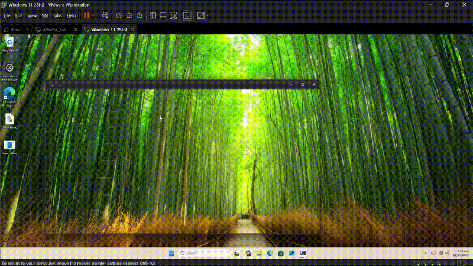
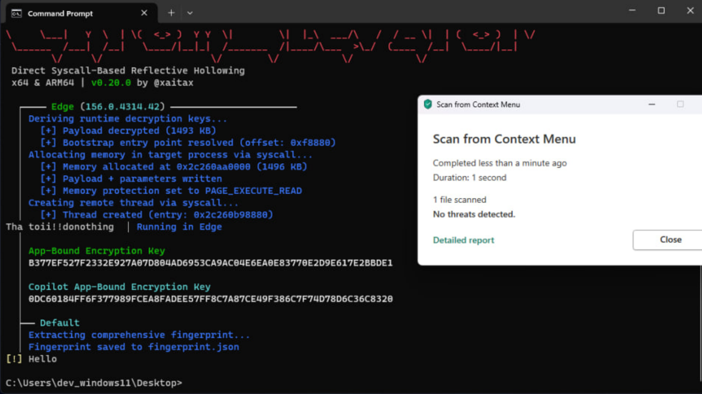
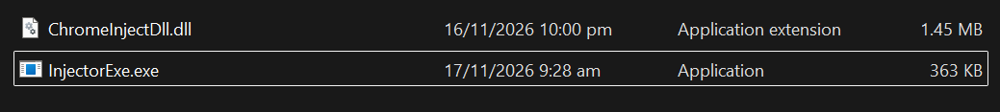

# ChromElevator (Chrome App-Bound Encryption Decryption)
Owner: https://github.com/xaitax/Chrome-App-Bound-Encryption-Decryption

## Demo

## Definition
Before: DPAPI
Chrome protected local data with the Data Protection API (DPAPI).
DPAPI only checks the current user’s security context. It does not need SYSTEM.
So any process running with the same privileges as Chrome can call CryptUnprotectData and decrypt the data.

Now: App-Bound Encryption (ABE)
Windows added ABE to fix this.
The core rule: the decryption key can only be requested by the Chrome process itself.
How it works?
- Chrome calls IElevator::EncryptData through COM to protect the app_bound_key. This also creates the validation_data.
- The validation_data and app_bound_key are combined into one block.
- The block is encrypted with DPAPI in the USER context.
- The result is encrypted again with DPAPI in the SYSTEM context.
- The final ciphertext is saved in Local State.

## Original Source Code Workflow
- The DLL is embedded into the EXE during compilation.
- The EXE decrypts the embedded DLL.
- It allocates memory inside the Chrome process and loads the DLL into Chrome's memory.
- It calculates the offset of the BootStrap function and calls it.
- BootStrap() acts as a loader. It maps its own sections into memory and creates a named pipe client.
- After collecting and decrypting the data, the DLL sends the results to the named pipe server created by the loader.

## Customized Source To Bypass AV/EDR

- Removed the need to encrypt the DLL into a separate .enc file.
- Separated the original source code into two components: Injected.exe and ChromeInjectDll.dll.

- Injected.exe loads the DLL from disk into memory before injecting it into the chrome.exe process.
- Renamed functions and variables and added code obfuscation to make the source code less recognizable.
- Removed existing signatures and customized the original code.
- Applied IAT Hiding to reduce the number of imported functions visible and avoid using highly signature Windows API like VirtualAlloc, VirtualAllocEx, CreateRemoteThread.
